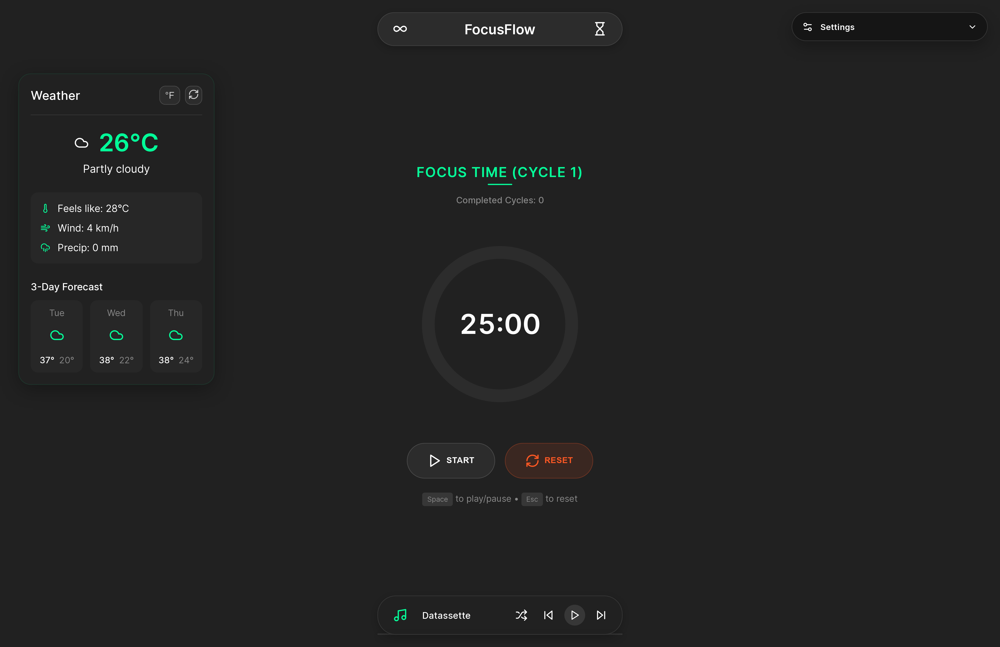

# FocusFlow

A modern focus workspace built with React and Vite.

FocusFlow combines a Pomodoro timer, adaptive ambient music, and live weather context in one fast interface designed for deep work.

## Highlights

- Smart Pomodoro workflow with focus, short break, and long break cycles
- Runtime settings panel for timer duration, audio, notifications, and volume
- Session persistence for timer state and user preferences via localStorage
- Integrated focus music player with 70+ tracks, shuffle, queue, and auto-play in focus phase
- Location-aware weather card with current conditions and 3-day forecast
- Keyboard shortcuts and browser notifications for smoother flow
- Responsive layout for desktop and mobile

## Preview



## Tech Stack

- React 19
- Vite 6
- Lucide React
- Plain CSS (tokenized theme system)
- Open-Meteo API

## Getting Started

### Prerequisites

- Node.js 18+
- npm 9+

### Install

```bash
git clone https://github.com/yourusername/FocusFlow.git
cd FocusFlow
npm install
```

### Run Development Server

```bash
npm run dev
```

### Build Production Bundle

```bash
npm run build
```

### Preview Production Build

```bash
npm run preview
```

## Available Scripts

| Script | Description |
| --- | --- |
| npm run dev | Start Vite dev server |
| npm run build | Build production assets |
| npm run preview | Serve built app locally |
| npm run lint | Run ESLint checks |

## How It Works

### Timer Engine

- Duration values are provided by the settings panel
- Focus and break phase transitions run automatically
- Timer progress is calculated from elapsed wall-clock time for better accuracy
- Timer session state is restored on refresh

### Settings System

- Settings are edited live in the in-app panel
- Preferences are persisted in localStorage
- Supports focus length, break lengths, long-break cycle, volume, sound cues, and notifications

### Player Behavior

- Audio is prepared per selected track and synced with timer phase
- Auto-play runs during focus sessions (when enabled)
- Supports previous, next, shuffle, and direct track selection

### Weather Module

- Uses browser geolocation (with permission)
- Fetches current weather + 3-day forecast from Open-Meteo
- Includes unit toggle and manual refresh

## Project Structure

```text
src/
  App.jsx
  App.css
  index.css
  components/
    Navbar.jsx
    Timer.jsx
    Player.jsx
    Weather.jsx
    SettingsPanel.jsx
```

## Browser Features Used

- Notification API
- Geolocation API
- HTML Audio API
- LocalStorage

## Accessibility and UX

- Keyboard shortcuts:
  - Space: Start or pause timer
  - Esc: Reset timer
- ARIA labels on key controls
- High-contrast neon theme with clear visual phase states

## Contributing

Contributions are welcome.

1. Fork the repository
2. Create a feature branch
3. Make your changes
4. Run lint and build checks
5. Open a pull request

## License

Licensed under the MIT License. See LICENSE for details.

## Credits

- Music source: Music for Programming
- Weather data: Open-Meteo
- Icons: Lucide

## Author

**Sajawal Mirza**
*(Pro-Prompter)*

- **LinkedIn**: [Sajawal Mirza](https://www.linkedin.com/in/sajawalmirza/)
- **Email**: [mirzasajawal827@gmail.com](mailto:mirzasajawal827@gmail.com)
